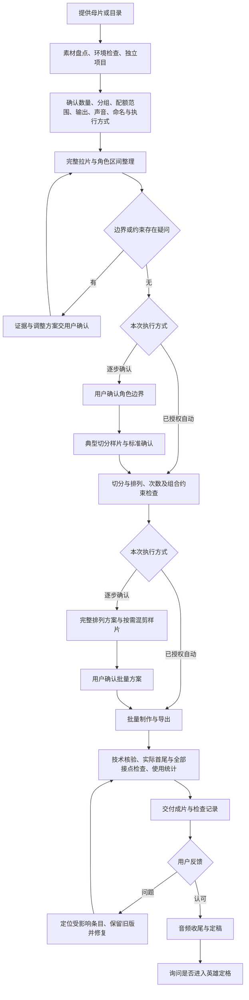
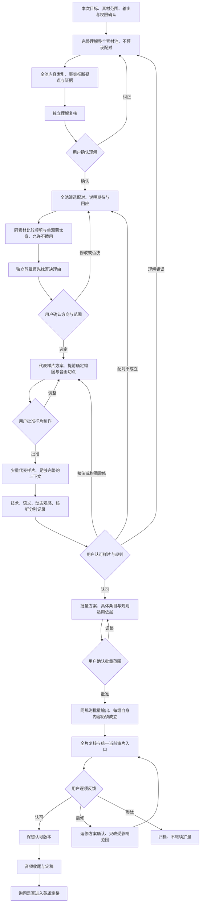

# 展示与剧情混剪：双方向流程蓝图

这是经用户确认的 1.9.0 开发源码流程。尚未发布为完整安装包；公开安装版本以 [最新 Release](https://github.com/William0702/role-showcase-remix/releases/latest) 为准。剧情本轮调整是基于真实反馈的流程修订，尚未重新完成新流程的整轮实测，不承诺整流程提速，也不宣称内部蒙太奇已有用户认可案例。

## 一、展示类：完整角色片段排列

目标：角色完整、切点准确、排列符合本批约束、次数可核对。问答明确当前需求后，按用户选定的自动或逐步方式推进；不会把历史项目的数量、配额或命名当作默认。

- 同一角色动作、变身、景别变化不自动拆成多个角色。真正无角色的纯文字尾帧按证据处理，不误删有角色的定格。
- 使用上限不等于必须用满。修订、改名及复用同一交付不额外累计；跨批配额不能悄悄重置。
- 独立子 Agent 按本次约定检查；技术通过不能代替实际内容审阅、核听或用户定稿。
- 当前默认自动技术链使用 FilmCraft、原声和本批配额，其他范围先明确能力与方案，不承诺全部条件都可一键执行。

执行细节：[展示自动模式](../../references/automatic-workflow.md)、[展示逐步模式](../../references/showcase-workflow.md)。

## 二、剧情 A/B：先理解，再筛配

目标：完整成片的因果、人物、口播、画面与情绪合理。A 是前段、B 是后段；真实内容优先于目录标签。全池审阅不等于强制用完所有素材。

- 同题材、画风相近、对白无冲突不足以支持强推荐；每组需说明 A 的具体期待与 B 的实际回应，避免人物/指代偷换或承诺落空。
- 顺剪与蒙太奇同时分析，不等于强制生产两版；重排必须有具体改善目标。改回顺序后获认可，不能统计为蒙太奇成功。
- 画幅、真实内容区域、人物及原字幕在样片前核对；不机械保留三栏包装，也不统一套固定裁切坐标。
- ASR 仅辅助定位，整段时间不直接当剪点；抽帧、PCM、相关度不等于连续审片或核听。技术、语义、动态观感、实际核听、用户认可五类分别记录。
- 独立审阅保留否决意见与证据，允许整组候选淘汰。无法分派或看/听时明示缺项，确认替代方式，不假称完成。
- 样片认可与批量授权绑定本项目明确规则、版本和条目；实质新规则不得混入。用户明确跳过样片时记录例外，不能填样片通过。

执行细节：[剧情共创](../../references/story-collaboration.md)、[全池索引与配对](../../references/story-pairing.md)、[剪法与授权](../../references/story-montage.md)。

## 共用收尾与第二阶段

成片认可后，沿用已经确认的本批音频选择；缺失时补问。新增去 BGM 等处理先给方案和短样段，用户核听认可后只处理选定范围，保留原声。音频能力不够或未核听如实记录。

用户明确确认具体成片定稿后，再询问是否需要英雄定格。需要才逐步进行：选帧确认→名称与排版确认→代表样张→原帧合成/纯绿文字/透明文字三类资产→静态确认→可选动画提示词。提示词交付不自动授权生成动画、上传、付费处理或追加成片。

新项目重新理解需求；保留明确范围内的旧决定，不把单个案例的片数、路径、作者名、引擎与审美偏好固化为全局规则。
