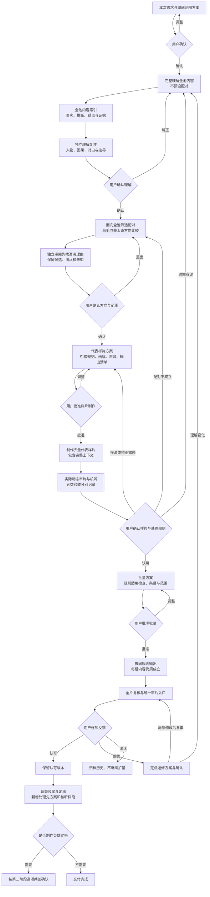

# 剧情 A/B 全池理解、共创与验收蓝图

## 目标与范围

面向不同用户与素材，优先保证完整成片的因果、人物、口播、画面和情绪合理。蒙太奇是可选手法；可编辑工程不是创作验收标准。具体素材结构、镜头和授权执行遵守 [剧情剪辑模块](story-montage.md)，索引与配对标准读取 [全池索引及配对](story-pairing.md)。本版为流程修订，尚未以新流程完成一轮真实验证。

每次先区分新项目、继续项目或改变目标，确认本次素材范围、目标、限制、输出与配额。A 是前段、B 是后段，不是人物身份；文件夹和名称不证明真实内容角色。完整片也要按真实内容审阅和拆解。本次采用 MP4 还是 FilmCraft 工程、是否跨母片、数量、人物、路径等均属项目选择，不推广为所有用户默认值。脚本和目录由 Agent 整理，不让用户填写技术配置。

## 核心顺序

**完整理解 → 全池内容索引 → 理解复核 → 全池配对方案 → 明确方案与代表样片 → 同规则批量输出 → 定点返修。**

“全池”是本次明确纳入的素材范围。先独立理解整个池，不预设 A/B 组合后挑着看；全池索引不是全池必须用完，不要求穷举渲染所有配对。内容缺失或损坏逐条记录，不谎报覆盖完成；缩小范围先说明并请用户确认。前置需求确认可授权本阶段的入库和拉片，不重复问已经获准的同一操作。

## 可视化蓝图

## 各阶段交付与确认

|阶段|交付给用户的内容|通过后进入|
|---|---|---|
|需求|目标、全池范围、输出选择、删减/重排/声音权限、必用禁用、配额对象和拉片计划|完整理解与全池索引|
|完整理解与索引|每部母片发生什么、人物与诉求、对白、前因后果、动作/情绪、真实内容区和声音；稳定 ID、帧/PTS、关键画面；事实/推断/疑点分开|理解复核及用户确认|
|理解复核|独立核查原素材与索引，纠正人物、因果、口播指代和边界；说明未解决项及其影响范围|全池配对，不先制作|
|配对方案|筛选后的候选与不采用理由；A 结束的承诺/问题和 B 如何回应；各候选的顺剪与单源蒙太奇方向、风险及完整播放概述|用户选方向，提出代表样片方案|
|代表样片方案|少量但覆盖不同承接规则和画幅类型；具体镜头、音画入口、适配策略、试听/审阅分工、输出清单和授权|仅制作获准样片|
|样片验收|足够完整 A、内部接点、A/B 接点与 B 必要上下文；实际效果及未完成项，用户选择修改或认可|锁定规则，提出批量方案|
|批量方案与输出|候选 ID/版本及实际输出范围、已认可样片/规则、每条适用依据、例外和配额；明确确认后批量|全片复核与用户验收|
|定点返修|认可/待审/需修/淘汰状态；只改具体问题并复查依赖，保留认可项与旧版|用户认可后定稿|

每轮只展示当前交付、独立审阅意见、需要决定的事项与下一步范围，用白话解释观看效果，再按需解释术语。用户确认不能由等待、技术指标、两个 Agent 一致意见或旧批授权替代。用户可以选择少量候选或整组否决；不能把“方案看过”当作“样片效果认可”。

## 代表样片与扩量边界

样片用于检验创作规则，不只是接缝能否播放。按内容选择数量，不固定一条、三条或某个时长；覆盖新叙事接法、内部重排、不同真实画幅和声音交接。相同规则的简单变体不必逐条重做样片，但画面、口播或因果发生实质变化的条目不能借旧样片批准自动混入。

样片通过后可复用本项目已验证规则、源哈希和审阅/边界记录；每组仍核对自身内容是否成立。新用户、新项目、新目标重新识别需求，不默认继承口味。批量确认绑定具体方案版本、规则、条目范围及输出；已明确批准范围不再逐条索要同一授权。用户明确要求跳过样片时，说明尚无动态校准、记录例外及具体范围，按其选择执行，不能记录“样片已通过”。

## 独立剪辑师与五类验收

独立子 Agent 先读当前需求、原素材与全池索引，独立形成判断，再看主 Agent 的推荐理由。先找否决理由，检查具体诉求是否被回应、承诺是否转移、指代是否偷换、对白是否断气、动作是否跳跃；允许全部候选被淘汰，不以“无明显冲突”或同题材作为充分依据。

预演或成片阶段给实际动态输出和上下文。记录问题 ID、版本、源/成片时间点、证据、观众理解影响、建议、实际查看与听音方式及范围。保留反对意见和主 Agent 回应，修改后复查受影响项。可复用同一审阅者，但不能把旧意见当成已检查新输出。

|验收维度|记录内容与限制|
|---|---|
|技术检查|解码、帧数、时长、音画同步、音轨与文件完整性；不证明故事或听感成立|
|语义关系|人物、因果、指代、诉求与回应；事实、推断及证据不足分开|
|动态剪辑观感|实际连续观看的版本、区间、节奏、动作和转场；抽帧/联系页不算连续审片|
|实际核听|谁听了哪个输出的哪段、结果与未听范围；ASR、PCM、相关度、响度不代替试听|
|用户认可|真实原文、具体版本、范围与采用/返修决定；一般“可以”不自行扩成全片已核听通过|

无法分派、连续观看或听音时明确缺项，向用户说明替代审阅与分工，得到确认后按该方式推进。用户承担核听也要记录实际反馈，不能因为其同意负责就填“已核听通过”。子 Agent 是独立工作程序，不保证绝无共同盲点，不替用户批准。

## 返修、项目记录与迭代

一个固定当前审片入口展示状态和当前采用版本；更新同一入口，旧版归档可追溯，不让用户在多个同名页面寻找新版。记录链为源 ID→区间→配对/剪法→输出版本→反馈/认可；裁切、放大、顺序修订属同一内容谱系，不虚算新创意、母片或额外配额使用。

理解错误退回理解并更新受影响候选，边界/构图/接点问题只重做相关输出，不因此重跑全池或重新扩量。新素材、源内容变化或审阅不足时补齐对应范围；内容哈希未变的技术缓存可复用，但不能替代本次语义关系判断。

项目内保存本次需求、全池内容索引、候选/淘汰清单、双方向分析、代表样片与规则、批量授权、五类验收和版本反馈。字段参考 [索引与配对模板](story-pairing.md)。通用改进写版本和验证依据；测试项目的具体人物、片数、路径、配额及引擎选择留在项目中。部分顺剪版本获认可不证明内部蒙太奇成功，也不证明全池永久不适合蒙太奇。新流程仍需实际验证。
