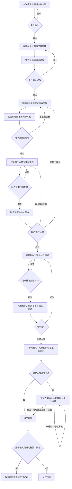

# 剧情逐步共创蓝图与阶段模板

## 目标与适用范围

供不同用户、素材与目标使用的通用流程，不依赖作者的电脑路径、历史对话或私人制作记录。核心是完整成片的剧情、口播、人物、画面和情绪合理；可编辑工程是次要交付。蒙太奇是手法，不是目标。具体剪辑边界、接点验收和执行授权仍遵守 [剧情模块](story-montage.md)。本模块是执行规范，不代表剧情全链路已真实测试通过。

每次识别新项目、原项目继续或目标改变。先输出本次任务理解，只补问缺失和冲突项。确认旧规则的适用范围，不能默认上一次任务就是本次需求；已确认且仍适用的答案不重复问。源码、工具随技能分发，素材、机器状态、私有路径和项目记录留在用户项目。项目中记录实际技能版本。

## 蓝图

理解错误随时退回理解阶段；其他局部问题退回对应环节。改动影响下游决定时，将受影响方案标为待复核，保留旧版本，不假称旧确认仍有效。每轮只呈现当前交付、审阅意见、需要决定的问题和下一步范围，等待真实回复后继续。首次前置方案可简短说明拟检查哪些素材、输出什么理解记录，无需用户填写技术配置。

## 阶段交付与用户确认

|阶段|必须输出|确认之后才能做什么|
|---|---|---|
|需求|当前目标、源范围、数量、画幅、音频、必用/禁用、允许删减、配额对象与范围、目录安排、拉片计划；缺项不套展示默认值|按确定范围拉片|
|理解|人物关系、事件经过、目标、因果、完整对白、情绪、A/B内容边界、可用片段区间；事实/推断/疑点分别标记|编制双方案|
|双方案|同组A/B各出顺剪与单源蒙太奇；完整内容概述、镜头序列、对白、承接理由、风险和推荐；不可行方向说明证据|细化选定方向的预演方案|
|预演方案|源ID/哈希、真实帧与PTS、独立音频区间、对白、接点、过渡、预演范围、输出清单、执行脚本及授权文件|制作预演|
|预演验收|实际预演与接点位置；技术、视觉、核听、语义和用户反馈分开记录|提出完整制作方案|
|完整方案|锁定镜头与音画安排、通过的预演版本、数量、输出参数、检查项、实际输出清单及完整授权|制作选定完整成片|
|全片验收|连续看全片、使用统计、音画同步、叙事及口播一致性、独立审片意见、未完成项|用户选择修改或认可|
|音频与定稿|沿用已确认音频要求；新增处理先方案和样段，通过才处理选定范围；保留原声；最终交付清单|用户定稿后再询问英雄定格|

需要用户确认的内容用白话配关键帧、完整对白与时间点呈现。先解释观看效果，再解释剪辑术语；给理由充分的推荐及不同意见，不把用户不懂术语视为同意。确认范围具体到版本和操作；等待、技术通过、两个Agent意见一致均不是用户确认。不擅自导出未选择的另一套方案。

## 独立剪辑师角色

每个阶段调用独立子Agent，以成熟叙事剪辑师标准检查。主Agent不能让它扮演用户或代替用户批准。给它当前用户要求、原素材访问路径、源哈希、相关完整上下文、待审方案与版本；审片阶段必须给实际预演或成片。先让它独立形成结论，再接收主Agent解释。不能只转交主Agent的剧情摘要让其背书。

审阅重点：人物与因果是否正确、对白是否整句且原意不变、AB是否有可理解关系、画面及情绪落差是否有依据、蒙太奇是否误导、接点与整片是否成立。不以色彩相似或过渡平滑代替语义合理，不为凑数量认可弱组合；必要时两套都拒绝。

每项意见记录：问题ID、方案版本、源/成片时间点或镜头、观察证据、对观众理解的影响、建议、实际查看/核听范围。结论为建议通过/修改后复审/不建议采用/证据不足。主Agent逐项回应并保留分歧；回复问题不等于问题已解决，修改后由审阅者复查受影响部分。

可复用同一独立审阅者，但每个新阶段必须获得对应的新证据并形成新记录。脚本和哈希由Agent维护，用户看到白话制作范围及效果说明，不要求用户读懂脚本才能确认。

子Agent独立性是工作程序，不能保证不存在共同盲点。环境不支持分派、查看或听音时，明确哪项未完成，向用户提出顺序自查或用户复核的替代方案，得到确认才以降级方式推进；不能假称完成独立审阅。用户可纠正审阅结论，也可要求重出。

## 项目记录模板

由Agent在用户项目中维护以下记录，目录名可按项目调整，不作为共享技能内的历史数据：

- 本次需求：项目ID、技能版本、目标、继承/重置范围、约束和用户确认原文。
- 剧情理解：源ID/哈希；人物、事件、对白、情绪；事实证据、推断依据、疑点和用户纠正。
- 可用片段表：片段ID、源、帧/PTS、画面、完整口播、叙事功能、前置上下文、出点信息、不可拆内容。
- 双方案：同组素材ID；顺剪/蒙太奇各自完整故事概述、镜头播放序列、音画安排、AB承接理由、风险、推荐及用户选择。
- 审阅与决策：阶段、版本、独立审阅意见、主Agent回应、未解决分歧、用户决定、批准操作范围。
- 制作验收：脚本和决定表哈希、授权、输出清单；技术/逐帧/连续观看/核听/用户验收分别记状态与证据。

## 持续迭代与回归

个人偏好留在项目，不自动升级为所有用户规则。记录问题属于素材、需求、理解、方案、执行还是流程缺陷；通用修改写明原因、影响场景、版本与验证证据。新需求不等于旧规则可继承。至少覆盖新项目、继续项目、改变目标、理解纠正、双方案均不可行、审阅分歧、无子Agent、音频未通过等场景；未实际执行的只标待测。通用流程变化检查展示模式不受影响。
